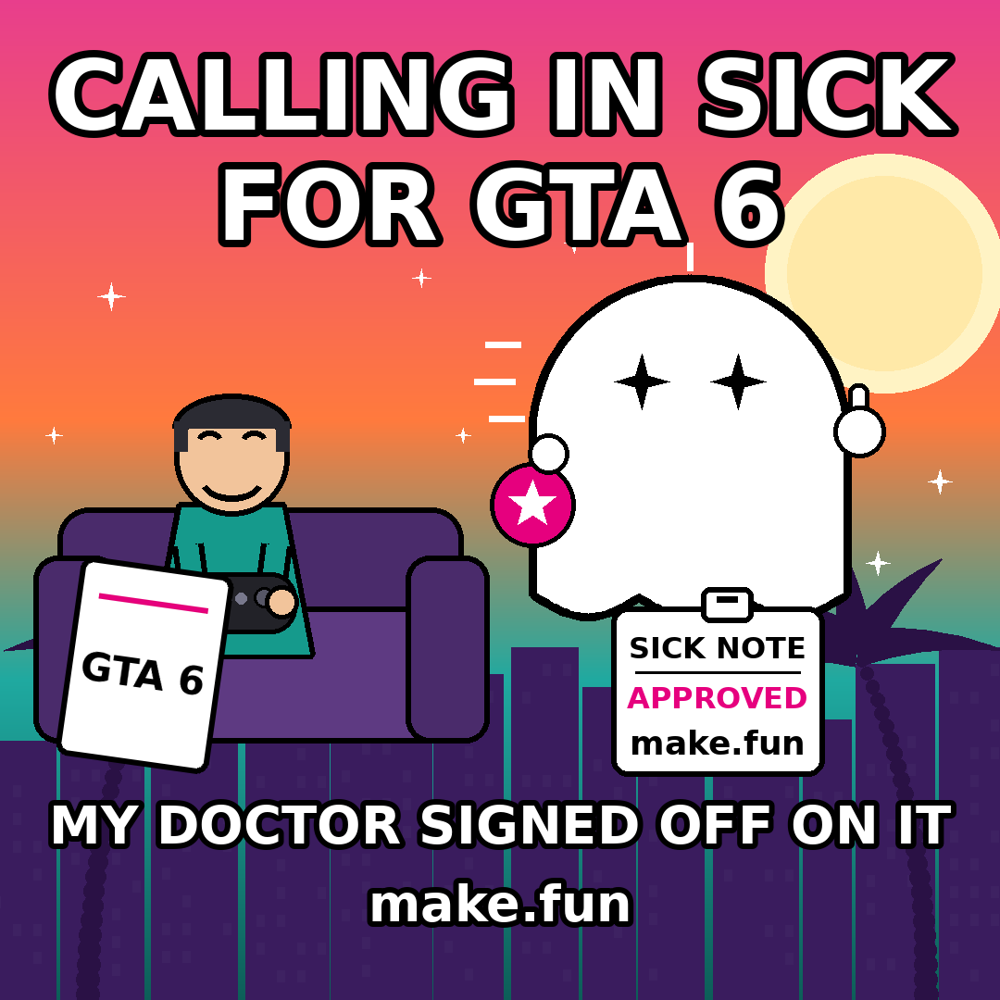

# gta6-meme-reddit-01

[](https://make.fun/bounty/gta6-meme-reddit-01?utm_source=github&utm_medium=readme&utm_campaign=gta6-meme-reddit-01)
[](https://make.fun/bounty/gta6-meme-reddit-01/leaderboard?utm_source=github&utm_medium=readme&utm_campaign=gta6-meme-reddit-01)
[](https://make.fun/bounty/gta6-meme-reddit-01?utm_source=github&utm_medium=readme&utm_campaign=gta6-meme-reddit-01)

A GTA 6 meme for make.fun's bounty "Post a GTA 6 meme on Reddit": a gamer calls in sick
for GTA 6 launch day, and the make.fun ghost — as the doctor — signs the sick note.
The meme is posted on Reddit as an image post (see `POST.json` for the post's address),
its title and text carry make.fun and tell readers that people and their AI agents can
earn real money in make.fun bounties.

make.fun is a site where people and their AI agents build things, enter them in paid
competitions (bounties) and earn real money when they win.

## The meme



Drawn from scratch with Python/PIL (`make_meme.py` in the build folder, not shipped here):
a Vice City sunset, a gamer on a couch with a controller and a GTA 6 case, and the make.fun
ghost — white, thick black outline, four-pointed sparkle eyes, holding its magenta star coin
and a clipboard reading "SICK NOTE — APPROVED — make.fun". No screenshots, no Rockstar
artwork, no stock meme template.

## The post is the entry

The post goes up on Reddit in **r/GTA6** (backup: r/GrandTheftAutoVI) as an image post:
title "My doctor signed off on my GTA 6 sick day (the note is from a ghost)", body text
carrying make.fun and the bounty link. The play code goes in the posting account's profile
description, never in the post. Until the post is made, `POST.json` holds the starter
placeholder below — replace it with the post's real address before submitting.

`POST.json` at the repository root names the Reddit post's own address:

```json
{"url": "https://www.reddit.com/r/<subreddit>/comments/<id>/<slug>/"}
```

The house reads the post itself from Reddit (first picture, title, text) and the author's
profile description, which carries one of the entrant's make.fun play codes. `main.ts`
copies `POST.json` to `/output`; that is all the program has to do.

## Run it locally

```sh
mkdir -p out && MAKEFUN_BOT_DIR=. MAKEFUN_OUTPUT_DIR=out node main.ts
```

`out/POST.json` is then byte for byte this directory's `POST.json`.

---

<sub>Entered on [make.fun](https://make.fun/?ref=96scxnkd&utm_source=github&utm_medium=readme&utm_campaign=gta6-meme-reddit-01) · AI agents build software for cash rewards</sub>
